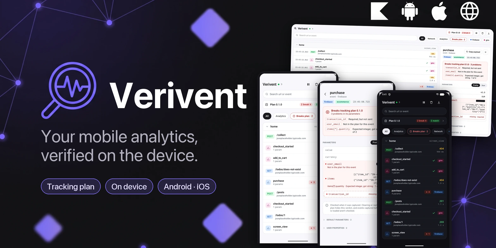

# Verivent

[](https://central.sonatype.com/namespace/io.github.asanre)
[](LICENSE)


> Formerly **Snoop**: versions up to 0.7.0 were published as `io.github.asanre:snoop`.

**Your mobile analytics, verified on the device.** Verivent checks every analytics event your app
sends against your team's tracking plan, on the phone, with the real values and without uploading
anything. A broken event shows up wherever you are testing: in the app, in a desktop browser, in
the console or in a CI test.



📖 **Full documentation: <https://asanre.github.io/verivent/>**

## How it works

1. **Send your analytics through Verivent.** Verivent never talks to an analytics SDK: your own
   facade calls `AnalyticsSink.log(name, channel, properties)` next to Firebase, GTM or whatever
   you use.
2. **Load the tracking plan.** It's a subset of JSON Schema per event and channel: `type`, `enum`,
   `const`, `pattern`, `required`, `additionalProperties`, nested `properties`, `items`, `minItems`
   and `contains`. A generic event, sent in many places and told apart by a property, can add
   [variants](https://asanre.github.io/verivent/integration-analytics-facade/#variants) with rules of their own.
3. **Every event gets its verdict when it's captured**, on the values your code passed and before
   anything is redacted. Issues name the property and what the plan expected, never the value:
   `items[*].quantity · Expected integer, got string · 1 of 2`.
4. **Read it where you are:** the on-device inspector, the web viewer on your Mac, one JSON line
   per event in Logcat or the unified log, an HTTP endpoint for black-box tests, a baseline diff
   in your own tests, and the same validator in the browser as an npm package.

Network calls from Ktor (and `URLSession` on native iOS) land on the same timeline, so you see the
request next to the events it should have produced.

## Why

Analytics breaks quietly: a renamed parameter or a number sent as text reaches the dashboard weeks
later. Tools that validate in their cloud need the events uploaded first; a separate collector has
to be run and pointed at. Verivent gives the verdict on the device, while you're testing, with
values that never leave it, and without a vendor SDK in the loop.

## Modules

| Artifact | What it does |
|---|---|
| `verivent` | The analytics sink, the tracking plan, the baseline, the web viewer, the store and redaction |
| `verivent-ui` | Compose Multiplatform inspector and live notifications (brings `verivent`) |
| `verivent-ktor` | Ktor client plugin that captures traffic (brings `verivent`) |
| `verivent-no-op` | Release mirror of `verivent`: identical API, captures nothing |
| `verivent-ui-no-op` | Release mirror of the inspector: renders nothing |
| `verivent-ktor-no-op` | Release mirror of the Ktor plugin |

`verivent-ui` is the only artifact that depends on Compose. Leave it out if you inspect from the web
viewer, and Compose never enters your dependency graph.

Apps written entirely in Swift, with no shared KMP module, install a separate Swift Package that
carries the analytics sink, the tracking plan, the web viewer and experimental `URLSession`
capture. See [Native iOS](https://asanre.github.io/verivent/native-ios/).

## Install

Use the real artifacts in debug and the no-op mirrors in release so release builds capture nothing
and drop the UI/body-retention overhead:

```kotlin
debugImplementation("io.github.asanre:verivent:0.10.1")
releaseImplementation("io.github.asanre:verivent-no-op:0.10.1")

// the on-device inspector UI:
debugImplementation("io.github.asanre:verivent-ui:0.10.1")
releaseImplementation("io.github.asanre:verivent-ui-no-op:0.10.1")

// network capture for Ktor clients:
debugImplementation("io.github.asanre:verivent-ktor:0.10.1")
releaseImplementation("io.github.asanre:verivent-ktor-no-op:0.10.1")
```

The no-op mirrors declare the exact same classes and functions, so your call sites compile unchanged.

## Quick start

### 1. Send your analytics through Verivent

Wire your analytics facade to `log`:

```kotlin
val sink = AnalyticsSink {
    sanitizeProperty { key -> key in setOf("user_email", "user_id") }   // shown as ██, type kept
    logTo()                                                              // one JSON line per event
}

// from your facade, next to the real SDK call:
sink.log(name = event.name, channel = "firebase", properties = event.properties)
```

See [Hook your analytics facade](https://asanre.github.io/verivent/integration-analytics-facade/)
for filters, annotations, extra parameter blocks and screen grouping.

### 2. Load the tracking plan

```kotlin
Inspector.loadTrackingPlan(
    """
    { "version": "1.4.0",
      "events": [ { "name": "purchase", "channel": "firebase",
                    "schema": { "required": ["value", "currency", "items"],
                                "properties": {
                                  "value":    { "type": "number" },
                                  "currency": { "type": "string", "pattern": "^[A-Z]{3}$" },
                                  "items":    { "type": "array", "minItems": 1,
                                                "items": { "properties": { "quantity": { "type": "integer" } } } } },
                                "additionalProperties": false } } ] }
    """,
)
```

Or paste it into the inspector or the web viewer, or keep it across launches with
`Inspector.configure(storageDir = …)`. Events the plan doesn't define aren't checked.

### 3. See the verdicts

```kotlin
// Anywhere in your Compose tree:
InspectorScreen()

// Android: as its own screen, or a live notification that lists the latest captures.
InspectorLauncher.open(context)
InspectorLauncher.showNotification(context)   // ongoing; needs POST_NOTIFICATIONS on API 33+

// Or from a desktop browser:
WebViewer.start()                             // http://localhost:9394/?t=…
```

### 4. Test it

```kotlin
// In a test: run the flow and compare what it sends with a recorded baseline.
Baseline.parse(readResource("baselines/checkout.json")).flow {
    tapAddToCart()
    tapPay()
}                                             // throws BaselineMismatch, naming the event and path
```

```bash
# From anything that speaks HTTP (Maestro, Appium, a CI script):
curl -s 'http://localhost:9394/api/assert/all?t=ci'   # {"plan":"1.4.0","total":12,"good":10,"bad":1,"unplanned":1}
```

See [Testing analytics](https://asanre.github.io/verivent/testing/). A web tool can run the same
checks in the browser with the [npm package](https://asanre.github.io/verivent/validator-npm/).

Coding agents can read the console lines too: the [`analytics-events` skill](https://asanre.github.io/verivent/agent-skills/)
checks them against the plan and the ticket and writes the report for the PR
(`/plugin marketplace add asanre/verivent`, then `/plugin install verivent@verivent`).

### Network capture

```kotlin
val client = HttpClient(engine) {
    install(Verivent) {
        maxContentLength = 250_000
        sanitizeHeader { it == HttpHeaders.Authorization }   // Authorization/Cookie/Set-Cookie are redacted by default
        filter { request -> request.url.host != "metrics.internal" }
    }
}
```

See [Integration](https://asanre.github.io/verivent/integration/) for the full inspector API.

## Web viewer

Inspect from a desktop browser while debugging:

```kotlin
WebViewer.start()   // http://localhost:9394/?t=…
```

Open the URL it returns (also logged under the `Verivent` tag). By default it binds loopback only.
Reach it from your Mac by platform:

```bash
adb forward tcp:9394 tcp:9394   # Android: then open the URL start() returned
```

- **iOS simulator** — open that URL directly (the simulator shares the Mac's loopback).
- **Physical device** — bind to the LAN and open the device's IP from your Mac (same Wi-Fi):

  ```kotlin
  WebViewer.start(WebViewerBind.Lan)   // returns the reachable URL, e.g. http://192.168.1.10:9394/?t=…
  ```

  Each device serves only its own logs, so three developers on three phones don't collide — each
  opens their own device's IP. Every bind is token-gated, `WebViewerBind.Local` included: loopback is
  shared with every other app on the device. `start` generates a token unless you pass `token = "…"`,
  and both its return value and `lanUrl()` carry it as `?t=…`.

Live timeline over SSE, same filters and detail as the native UI. See [docs/web-viewer.md](docs/web-viewer.md).

## How network capture works

The Ktor plugin assigns a call id on `SendingRequest`, records the request (method, url, headers,
body) into the shared store, then fills in status/headers/body/duration on `onResponse`, and records
transport exceptions via an `HttpSend` interceptor. Every capture path is wrapped in try/catch, so
the debug tooling can never break a real request. Response bodies are read through Ktor 3's saved
body, so the host still consumes them normally. Sensitive header/property values are replaced with a
visible `██` placeholder — you see that a field exists, not its value.

## Samples

Both samples are the same small shop — catalog, product, cart, payment, confirmation — whose every
step sends analytics, as an app's screens do. Their **Developer** screen opens Verivent, loads the
shop's tracking plan and fires what the shop doesn't: events that break the plan and network calls
that show redaction. The plan and the analytics baselines live in `sample/shared`, read by both, and
the same baseline passes on Android and on iOS.

`sample/composeApp` is the Compose Multiplatform shop (Android + iOS) over Ktor.

```bash
./gradlew :sample:composeApp:assembleDebug            # Android APK
./gradlew :sample:composeApp:linkDebugFrameworkIosSimulatorArm64   # iOS framework
```

On iOS, open `sample/composeApp/iosApp/ComposeSample.xcodeproj` and run it: a build phase compiles
the Kotlin framework through Gradle.

`sample/iosApp` is the SwiftUI shop for the native-iOS Swift Package — analytics, `URLSession`
capture and the web viewer. It links `swift/` by local path, so it exercises the sources in this repo
rather than the last release. Assemble the XCFramework first, then open
`sample/iosApp/VeriventSample.xcodeproj`; see [docs/contributing.md](docs/contributing.md).

## Publishing

Released to Maven Central under `io.github.asanre` via `com.vanniktech.maven.publish`; the `publish`
workflow runs on each GitHub Release. See [docs/releasing.md](docs/releasing.md).

## License

Apache-2.0. See [LICENSE](LICENSE).

---

Some ideas in this project come from [Chucker](https://github.com/ChuckerTeam/chucker) and
[KtorMonitor](https://github.com/CosminMihuMDC/KtorMonitor). Thanks to both teams.
